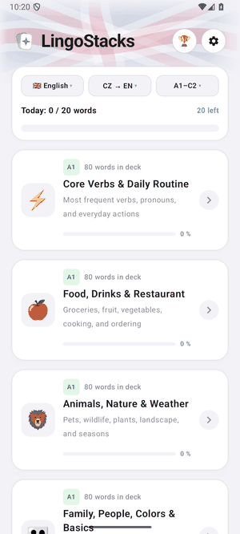
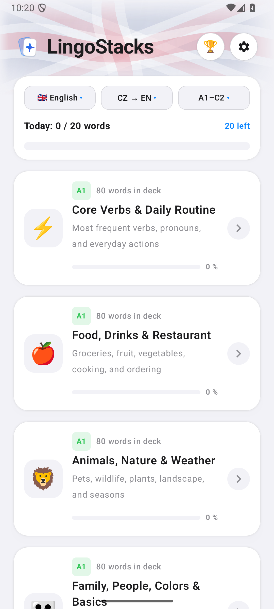
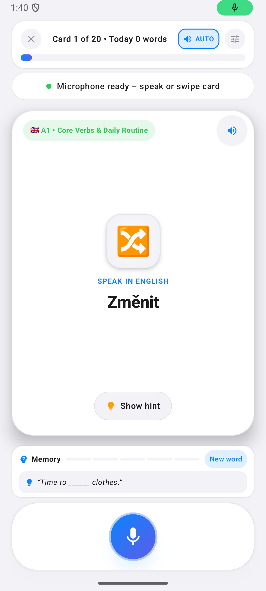
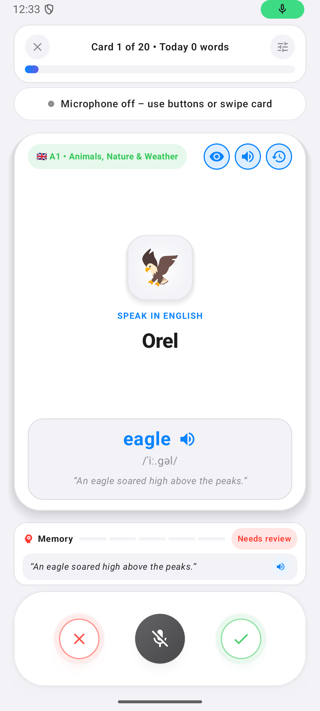
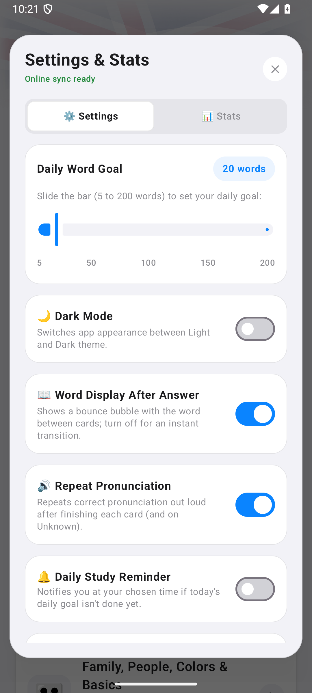
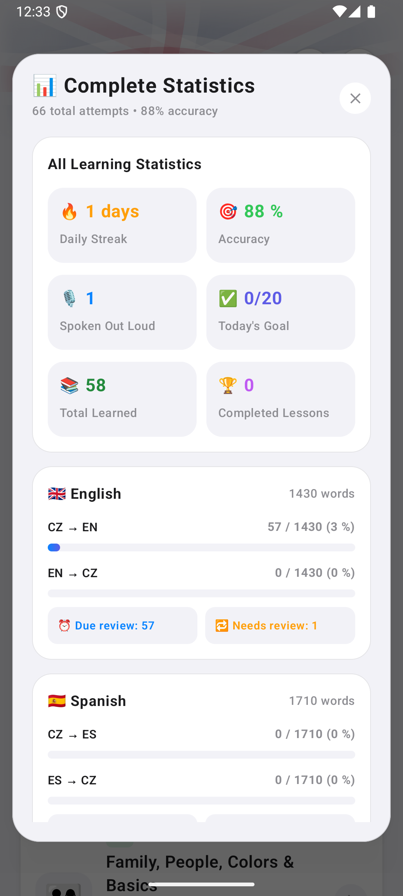

  <a href="README.md">🇬🇧 English</a> | 🇨🇿 <strong>Česky</strong>

# 🗣️ LingoStacks — Hlasová multijazyčná výuka slovíček pro Android

Moderní Android aplikace v designu **Cupertino Glass** pro aktivní procvičování **6 světových jazyků** (angličtina, španělština, němčina, francouzština, italština a portugalština) z **libovolného rodného jazyka** pomocí vašeho hlasu, plynulých gest a chytrého intervalového opakování (*Spaced Repetition*).

<table>
  <tr>
    <td>
      <h3>⬇️ Stáhnout a vyzkoušet (Android 8.0–16 / API 26–36)</h3>
      

        
        
        
      

      

        🌐 <strong>Prezentační web:</strong> <a href="https://radekvlk.github.io/LingoStacks/">radekvlk.github.io/LingoStacks</a> 
        📦 <strong>Všechna vydání:</strong> <a href="https://github.com/radekvlk/LingoStacks/releases/latest">GitHub Releases</a> 
        📱 <strong>Google Play:</strong> V uzavřeném testování (v1.0.0, API 36)
      

      
Naskenujte QR kód foťákem telefonu pro okamžité stažení nejnovějšího APK.

    </td>
    <td align="center" width="160">
      
    </td>
  </tr>
</table>

## 📸 Ukázky z aplikace

  

  
  
  
  
  

## ✨ Hlavní funkce

- **🌍 Globální multijazyčná podpora (Cross-Language Native Bridge):**
  - Aplikace není vázána pouze na češtinu! Nastavte si svůj **rodný výchozí jazyk** ze 7 možností: **čeština, angličtina, španělština, němčina, francouzština, italština nebo portugalština**.
  - Učte se libovolný z **6 cílových jazyků** s více než **30 vzájemnými kombinacemi**. Veškerá zadání, nápovědy, příkladové věty, rozpoznávání hlasu i hlasová syntéza se automaticky přizpůsobí vybranému rodnému a cílovému jazyku.
- **🔄 Obousměrné učení (`Rodný ↔ Cílový` i `Mix`):**
  - Rychlé přepínání mezi režimy **Rodný → Cílový (aktivní vybavení)**, **Cílový → Rodný (pasivní poslech a porozumění)** nebo **Dynamický Mix** přímo z horní lišty (**Jazyk • Směr • Úroveň**) pod vlající vlajkou vybraného jazyka i v Nastavení.
  - V pasivním směru (Cílový → Rodný) aplikace cizí slovo ihned automaticky nahlas přečte (`AUTO`), rozpoznává váš překlad v rodném jazyce a ukládá **oddělené SRS intervaly**, takže pasivní trénink nikdy nezkreslí vaši aktivní úroveň zvládnutí.
- **🎙️ Nepřetržité hlasové procvičování (`SpeechRecognizer`):**
  - Říkejte překlady přirozeně nahlas — aplikace průběžně poslouchá ve všech podporovaných jazycích, uplatňuje jazykově specifickou fonetickou toleranci ve `WordMatcher` (přesnost na členy, diakritiku, elize i synonyma), ihned vyhodnotí odpověď, přehraje rodilou výslovnost (`TextToSpeech`) a plynule posune kartu dál.
  - Vizuální animovaný ekvalizér v reálném čase a automatické skrývání/zobrazování tlačítek **Vím / Nevím** s plynulou *bounce* animací při ztlumení mikrofonu.
- **📚 9 980+ slovíček a frází ve 114 tematických sadách (A1–C2):**
  - 🇬🇧 **Angličtina (1 430 položek / 19 balíčků):** slovní zásoba A1–C2, základní i pokročilá **nepravidelná slovesa** (všechny 3 tvary) a praktické cestovatelské i konverzační **fráze**.
  - 🇪🇸 **Španělština (1 710 položek / 19 balíčků):** slovní zásoba A1–C2, **nepravidelná slovesa** (*presente* i minulý čas *indefinido*) a každodenní i cestovní **fráze**.
  - 🇩🇪 **Němčina (1 710 položek / 19 balíčků):** slovní zásoba A1–C2 se členy, **nepravidelná slovesa** (přítomný i minulý čas / *Partizip II*) a konverzační i cestovní **fráze**.
  - 🇫🇷 **Francouzština (1 710 položek / 19 balíčků):** slovní zásoba A1–C2 se členy, **nepravidelná slovesa** (*présent* i *passé composé*) a konverzační i cestovní **fráze**.
  - 🇮🇹 **Italština (1 710 položek / 19 balíčků):** slovní zásoba A1–C2 se členy, **nepravidelná slovesa** (*presente* i *passato prossimo*) a praktické i cestovní **fráze**.
  - 🇵🇹 **Portugalština (1 710 položek / 19 balíčků):** slovní zásoba A1–C2 se členy, **nepravidelná slovesa** (*presente* i *pretérito perfeito*) a každodenní i cestovní **fráze**.
- **🃏 Plynulé Swipe kartičky a kontextová nápověda:**
  - Gesto **doprava (Vím)** / **doleva (Nevím)** s okamžitým odsunem karty a paralelním poslechem výslovnosti.
  - Výsuvná nápověda s fonetickým přepisem, poslechem příkladové věty jedním klepnutím a historií nedávných pokusů.
- **🧠 Vědecky řízené opakování (Leitner + SM-2):**
  - Slovíčka s chybou nebo nápovědou se vracejí v optimálních intervalech zvlášť pro aktivní mluvení i pasivní porozumění.
- **☁️ Cloudová záloha a komunitní žebříčky:**
  - Přihlášení jedním klepnutím přes **Google účet** a bezpečná synchronizace přes Firebase Firestore. O svůj postup ani sérii dnů nepřijdete ani při změně zařízení.
  - Denní a týdenní žebříčky s kartami profilů pro zdravou motivaci.
- **📱 Optimalizace pro skládací a velké telefony:**
  - Responzivní rozvržení s dvousloupcovým zobrazením pro skládací zařízení (např. Galaxy Z Fold, Pixel Fold) a tablety.
- **🚀 Duální distribuce a GitHub OTA aktualizace:**
  - **Google Play:** Verze 1.0.0 v uzavřeném testování.
  - **GitHub Releases:** Přímé stažení APK s automatickou kontrolou nových verzí, instalací jedním klepnutím přímo v aplikaci a zachováním dat díky konzistentnímu podpisu.

---

## ⬇️ Stažení a instalace (Android 8.0+)

Nejnovější oficiální balíček **`LingoStacks.apk`** najdete vždy v sekci [**Releases na GitHubu**](https://github.com/radekvlk/LingoStacks/releases/latest).
Další aktualizace se instalují pohodlně přímo v aplikaci přes OTA.

> [!NOTE]
> **Varování Google Play Protect při instalaci mimo obchod:** Při přímé instalaci APK z GitHubu může Android zobrazit standardní bezpečnostní výzvu *(„Nebezpečná aplikace zablokována“ / „Harmful app blocked“)*. **Není čeho se bát** — hlášení se zobrazuje automaticky, protože aplikace používá mikrofon pro hlasovou výuku a stahuje aktualizace přímo z GitHubu namísto Obchodu Play. Veškerý zdrojový kód aplikace je veřejně auditovatelný zde v repozitáři. Pro pokračování v instalaci stačí klepnout na **Více informací → Přesto nainstalovat**.

---

## 🛠️ Technické informace

- **Jazyk & UI:** Kotlin 2.0+, Jetpack Compose, Material 3 (téma Cupertino Glass)
- **Minimální verze Android:** Android 8.0 (API 26) • **Target SDK:** Android 16 (API 36)
- **Architektura:** Clean Architecture + MVVM, StateFlow, Kotlin Coroutines, Room / SharedPreferences / Firebase Firestore
- **Zvuk & Řeč:** Android `SpeechRecognizer` (plynulá smyčka s auto-restartem), Android nativní `TextToSpeech` (s okamžitým pre-cachingem)
- **Oprávnění:** `RECORD_AUDIO` (hlasové procvičování), `INTERNET` (synchronizace a žebříček), `REQUEST_INSTALL_PACKAGES` (přímá instalace OTA aktualizací)

---

## 📄 Autorská práva (*All Rights Reserved*)

**© 2026 Radek Vlk — Všechna práva vyhrazena (*All Rights Reserved*).**

Zdrojový kód je zveřejněn výhradně pro nahlédnutí a ověření bezpečnosti aplikace (*source-available*). Bez předchozího výslovného písemného souhlasu autora není dovoleno kód ani jeho části kopírovat, upravovat, dále šířit ani vydávat jako vlastní nebo odvozenou aplikaci.
