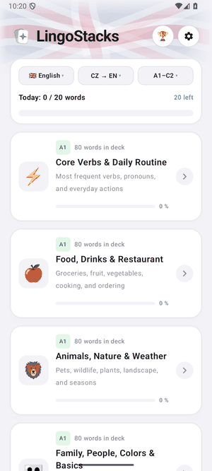

  🇬🇧 <strong>English</strong> | <a href="README.cs.md">🇨🇿 Česky</a>

# 🗣️ LingoStacks — Voice-First Flashcard Language Learning for Android

A modern Android app in **Cupertino Glass** design for actively practicing **5 world languages** (English, Spanish, German, French, and Italian) using your voice, swipe gestures, and smart *Spaced Repetition*.

<table>
  <tr>
    <td>
      <h3>⬇️ Download & Try (Android 8.0+)</h3>
      

        
        
      

      

        🌐 <strong>Project Website:</strong> <a href="https://radekvlk.github.io/LingoStacks/">radekvlk.github.io/LingoStacks</a> 
        📦 <strong>All Releases:</strong> <a href="https://github.com/radekvlk/LingoStacks/releases/latest">GitHub Releases</a>
      

      
Scan the QR code with your phone to download the latest APK directly.

    </td>
    <td align="center" width="160">
      
    </td>
  </tr>
</table>

## 📸 App Preview & Screenshots

  

  
  
  
  
  

## ✨ Key Features

- **🔄 Bidirectional Learning (`CZ ↔ EN/ES/DE/FR/IT` & `Mix`):**
  - Quickly switch between **CZ → Foreign Language (active recall)**, **Foreign Language → CZ (passive comprehension)**, or **Mix of both directions** right from the symmetrical top bar (**Language • Direction • Level**) beneath a subtle waving flag of the selected language, as well as in Settings.
  - In the reversed direction, the app displays the foreign word with pronunciation, reads it aloud automatically (`AUTO`), recognizes **Czech translations via `cs-CZ` speech recognition** (including synonyms and minor inflection differences), and stores **separate SRS intervals** for passive recall so active mastery stays unaffected.
- **🎙️ Continuous Voice Recognition (`SpeechRecognizer`):**
  - Speak the translation aloud — the app listens continuously in English, Spanish, German, French, Italian, and Czech (`cs-CZ`), applies language-specific phonetic tolerance in `WordMatcher`, evaluates answers instantly, plays native pronunciation (`TextToSpeech`), and advances smoothly to the next card.
  - Real-time visual voice equalizer and automatic hiding/showing of the **Know / Don't Know** buttons with a *bounce* animation when the mic is muted.
- **🃏 Smooth Swipe Cards & Smart Context:**
  - Swipe **right (Know)** / **left (Don't Know)** with immediate smooth card dismissal and parallel pronunciation playback.
  - Expandable hint with phonetic transcription, one-tap example sentence audio, and recent attempt history.
- **📚 8,270+ Words & Phrases Across 95 Thematic Decks (A1–C2):**
  - 🇬🇧 **English (1,430 items / 19 decks):** A1–C2 vocabulary, essential and advanced **irregular verbs** (3 forms), and high-frequency travel & conversational **phrases**.
  - 🇪🇸 **Spanish (1,710 items / 19 decks):** A1–C2 vocabulary, **irregular verbs** (present & past *indefinido*), and everyday & conversational **phrases**.
  - 🇩🇪 **German (1,710 items / 19 decks):** A1–C2 vocabulary with articles, **irregular verbs** (present & past / *Partizip II*), and travel & conversational **phrases**.
  - 🇫🇷 **French (1,710 items / 19 decks):** A1–C2 vocabulary with articles, **irregular verbs** (*présent* & *passé composé*), and travel & conversational **phrases**.
  - 🇮🇹 **Italian (1,710 items / 19 decks):** A1–C2 vocabulary with articles, **irregular verbs** (*presente* & *passato prossimo*), and travel & conversational **phrases**.
- **🧠 Smart Spaced Repetition (Leitner + SM-2):**
  - Unknown words and words answered with a hint automatically return at optimal intervals, tracked separately for active and passive learning directions.
- **📱 Foldable Phone Optimization (Galaxy Z Fold):**
  - Two-column landscape layout for comfortable use on large screens.
- **🏆 Daily Goal, Streak & Online Leaderboard:**
  - Automatic midnight daily goal reset, streak tracking, overall vocabulary progress, and a compact daily leaderboard with *bounce* player details.
- **🚀 Unified GitHub OTA Updates (`release`):**
  - Automatic update checks via **GitHub Releases**, one-tap in-app download of the optimized `release` APK (with bilingual changelog and Play Protect guidance), and full progress preservation thanks to a consistent signing key.

---

## ⬇️ Download & Installation (Android 8.0+)

The latest **`LingoStacks.apk`** installer is always available in [**Releases**](https://github.com/radekvlk/LingoStacks/releases/latest).
Subsequent updates are delivered OTA directly inside the app.

> [!NOTE]
> **Google Play Protect Warning During Installation:** When sideloading an app outside Google Play, Android may show a warning *(“Harmful app blocked” / „Nebezpečná aplikace zablokována“)*. **There is nothing to worry about** — this notice appears automatically because the app uses the microphone for voice learning and direct GitHub OTA updates rather than Play Store distribution. The entire source code is publicly available right here in this repository. To continue, tap **More details → Install anyway**.

---

## 🛠️ Technical Information

- **Language & UI:** Kotlin, Jetpack Compose, Material 3
- **Minimum Android:** Android 8.0 (API 26) • **Target SDK:** Android 15 (API 35)
- **Permissions:** `RECORD_AUDIO` (voice practice), `INTERNET` (leaderboard sync & OTA), `REQUEST_INSTALL_PACKAGES` (direct OTA APK install)

---

## 📄 Copyright (*All Rights Reserved*)

**© 2026 Radek Vlk — All Rights Reserved.**

The source code is published strictly for inspection and security verification (*source-available*). Without prior written permission from the author, copying, modifying, redistributing, or publishing the code or any of its parts as your own or a derivative application is not permitted.
