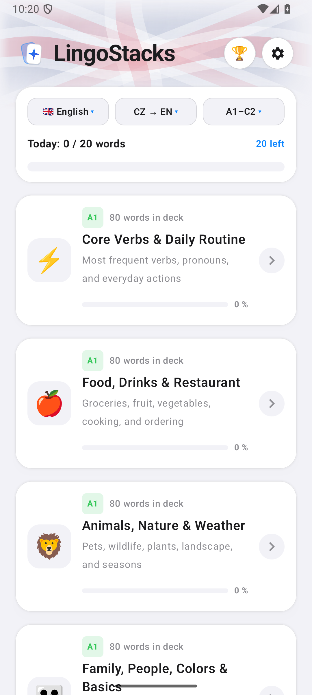
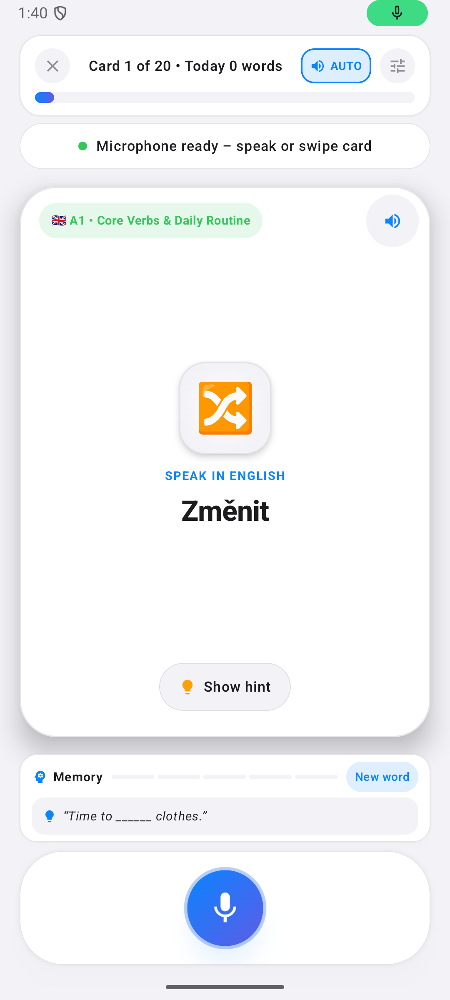
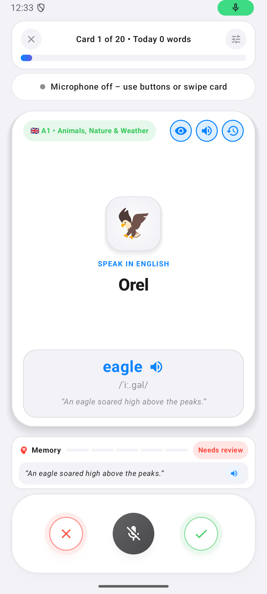
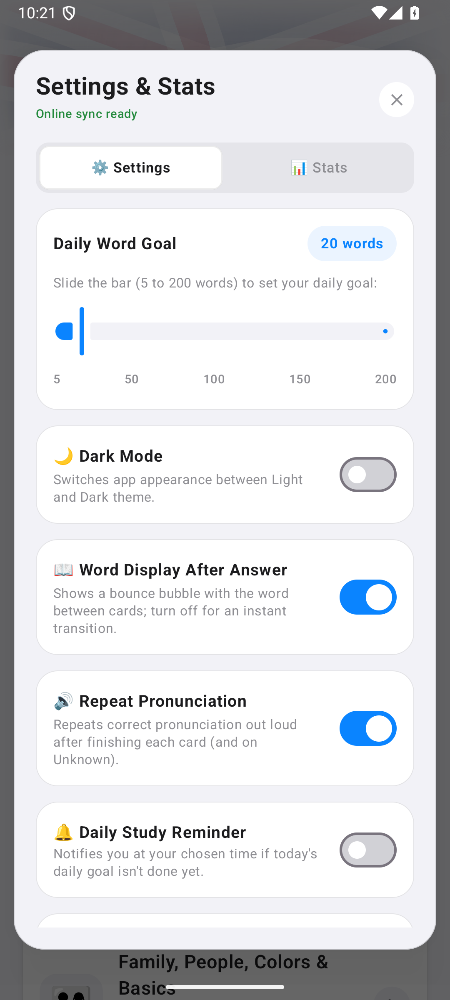
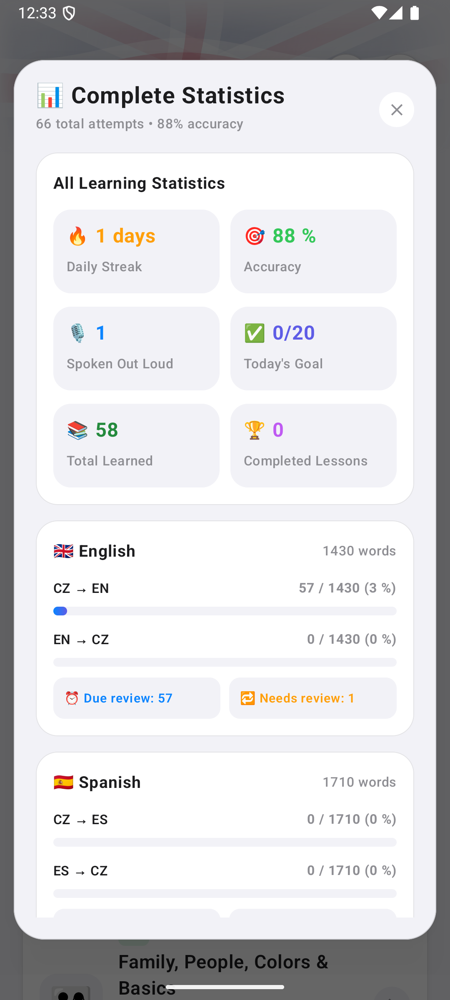

# 🗣️ LingoWords — Chytrá hlasová výuka slovíček pro Android

Moderní Android aplikace v designu **Cupertino Glass** pro aktivní procvičování angličtiny a španělštiny hlasem, gesty a chytrou metodou opakování (*Spaced Repetition*).

## 📸 Ukázky z aplikace

  
  
  
  
  

## ✨ Hlavní funkce

- **🎙️ Nepřetržité rozpoznávání hlasu (`SpeechRecognizer`):**
  - Vyslov překlad nahlas – aplikace průběžně poslouchá, toleruje drobné odchylky i českou výslovnost, ihned vyhodnotí odpověď, přehraje rodilou výslovnost (`TextToSpeech`) a plynule přejde na další kartu.
  - Vizuální hlasový ekvalizér v reálném čase a automatické skrývání tlačítek **Vím / Nevím** s *bounce* animací při vypnutí mikrofonu.
- **🃏 Plynulé Swipe kartičky & nápověda:**
  - Gesto **doprava (Vím)** / **doleva (Nevím)** s okamžitým plynulým odsunem karty a paralelní výslovností.
  - Rozbalovací nápověda s fonetickým přepisem a příkladovou větou.
- **📚 3 140 slovíček a frází v 38 tematických okruzích (A1–C2):**
  - 🇬🇧 **Angličtina (1 430 položek / 19 okruhů):** slovní zásoba A1–C2, základní i pokročilá **nepravidelná slovesa** (trojice tvarů) a nejpoužívanější cestovatelské i konverzační **fráze**.
  - 🇪🇸 **Španělština (1 710 položek / 19 okruhů):** slovní zásoba A1–C2, **nepravidelná slovesa** (přítomný i minulý čas *indefinido*) a nejpoužívanější každodenní i konverzační **fráze**.
- **🧠 Chytré opakování (Leitner + SM-2):**
  - Neznámá slovíčka a slovíčka s nápovědou se automaticky vrací v optimálních intervalech pro dlouhodobé zapamatování.
- **📱 Optimalizace pro skládací telefony (Galaxy Z Fold):**
  - Dvousloupcové rozvržení na šířku (*landscape*) pro pohodlné ovládání na velkém displeji.
- **🏆 Denní cíl, streak a online žebříček:**
  - Automatické půlnoční nulování denního cíle, sledování řady dnů (*streak*), celkový progres slovní zásoby a kompaktní denní žebříček s *bounce* detailem hráčů.
- **🚀 Jednotné GitHub OTA aktualizace:**
  - Automatická kontrola nových verzí z **GitHub Releases**, stažení APK jedním kliknutím přímo v aplikaci a zachování veškerého postupu díky stálému podpisu.

---

## ⬇️ Stažení a instalace (Android 8.0+)

Nejnovější instalační balíček **`LingoWords.apk`** najdete vždy v sekci [**Releases**](https://github.com/radekvlk/LingoWords/releases/latest).
Další aktualizace probíhá OTA přímo v aplikaci.

> [!NOTE]
> **Varování Google Play Protect při instalaci:** Při instalaci aplikace mimo Obchod Play může Android zobrazit varování *(„Nebezpečná aplikace zablokována“ / „Harmful app blocked“)*. **Není potřeba se toho obávat** — hláška se objevuje automaticky jen proto, že aplikace používá mikrofon pro hlasové učení a přímé OTA aktualizace z GitHubu a není distribuována přes Obchod Play. Veškerý zdrojový kód aplikace je veřejně dostupný zde v repozitáři. Pro pokračování stačí v okně klepnout na **Více informací → Přesto nainstalovat** (*More details → Install anyway*).

---

## 🛠️ Technické informace

- **Jazyk & UI:** Kotlin, Jetpack Compose, Material 3
- **Minimální Android:** Android 8.0 (API 26) • **Target SDK:** Android 15 (API 35)
- **Oprávnění:** `RECORD_AUDIO` (hlasové procvičování), `INTERNET` (synchronizace žebříčku a OTA), `REQUEST_INSTALL_PACKAGES` (přímá instalace OTA aktualizace)
